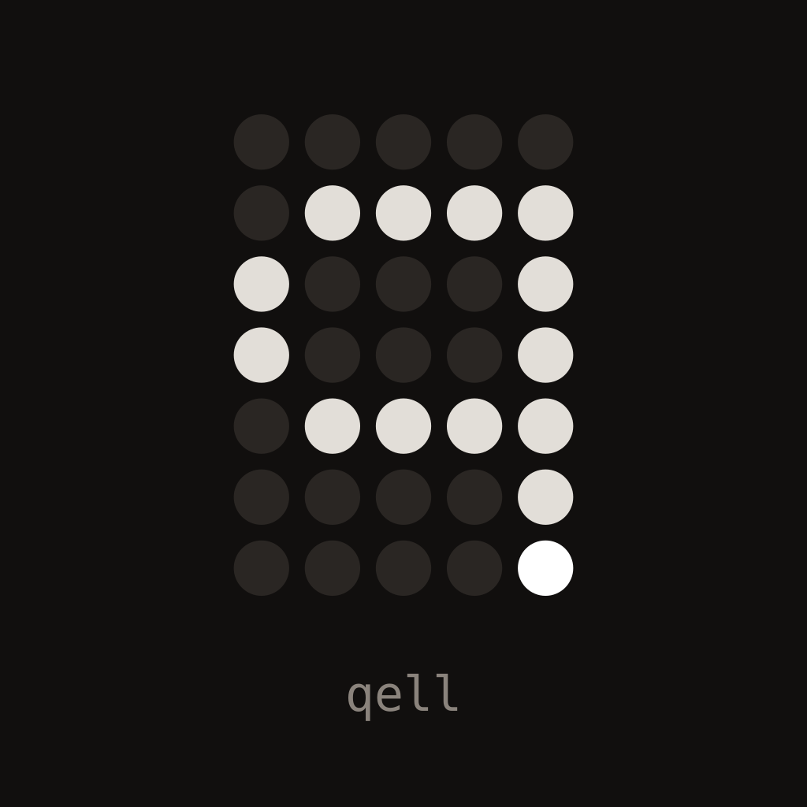
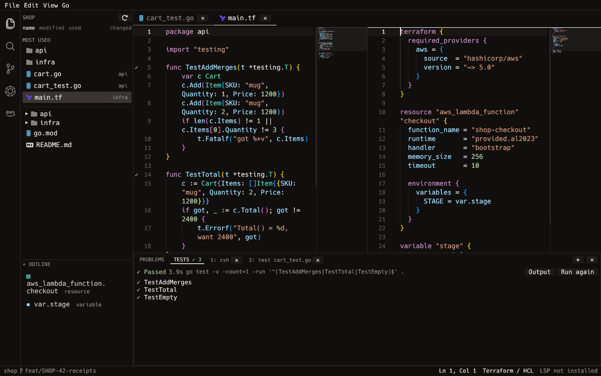

<p align="center"></p>

<p align="center"><b>A quiet, native code editor.</b><br>
<a href="https://sudo-bngz.github.io/qell/">Website</a> ·
<a href="https://sudo-bngz.github.io/qell/docs/">Documentation</a> ·
<a href="https://github.com/sudo-bngz/qell/releases/latest">Download</a> ·
<a href="CHANGELOG.md">Changelog</a></p>



Qell is a code editor written in Rust that looks like a terminal: near-black,
off-white, one monospace font, no decoration. One native window holds a file
tree, your code, a terminal and the tools of backend and infrastructure work
— language servers, git, tests, Kubernetes and AWS — all from the keyboard.

> **Preview (0.1).** Used every day by its author for Go, Rust, TypeScript
> and Terraform. It backs up unsaved work and writes a crash report if
> something breaks, but expect rough edges — please
> [open an issue](https://github.com/sudo-bngz/qell/issues) when you hit one.

## Nothing in the background

No telemetry, no auto-updates, no marketplace, no language server downloaded
behind your back. Qell uses the tools you already have — your `gopls`, your
`kubectl`, your `aws`, your shell — and when one is missing it tells you, in
plain words, the command to install it. Lists refresh only while you look at
them, tests run when you click ▶, and the daily log talks to an LLM only when
you ask.

## What's inside

- **Editor** — multiple cursors, folding, split view, minimap, sticky
  scroll, outline, soft wrap, Vim mode; tree-sitter highlighting for some
  twenty languages, Terraform and Dockerfiles included.
  → [Editing](https://sudo-bngz.github.io/qell/docs/editing.html)
- **Language servers** — completion, hover, go to definition, rename,
  diagnostics, signature help, inlay hints, format on save.
  → [Languages](https://sudo-bngz.github.io/qell/docs/languages.html)
- **Git** — status everywhere, changes in the gutter, hunk staging, blame,
  the commit graph, branches, stash and a one-click conflict resolver;
  works on a folder of many repositories.
  → [Git](https://sudo-bngz.github.io/qell/docs/git.html)
- **Local history** — a copy of each file every time you save it, on your
  machine, to compare with or restore. → [Local history](https://sudo-bngz.github.io/qell/docs/history.html)
- **Tests** — a ▶ beside each Go, Rust, Jest, Vitest or pytest test; ✓ or
  ✗ after the run, and a Tests tab that opens what failed.
  → [Tests](https://sudo-bngz.github.io/qell/docs/tests.html)
- **Tasks** — `make`, npm, just or your own `.qell/tasks.toml` commands,
  picked with `Ctrl/⌘+Shift+B` and run in a terminal tab.
  → [Tasks](https://sudo-bngz.github.io/qell/docs/tasks.html)
- **Terminal** — Alacritty's core, with tabs and shells that come back.
  → [Terminal](https://sudo-bngz.github.io/qell/docs/terminal.html)
- **Kubernetes and AWS** — k9s-style views driven by your own `kubectl` and
  `aws` CLI. → [Kubernetes](https://sudo-bngz.github.io/qell/docs/kubernetes.html),
  [AWS](https://sudo-bngz.github.io/qell/docs/aws.html)
- **Daily log** — what you committed, saved, tested and ran, summed up for
  stand-up by the LLM you choose; stays on your machine.
  → [Daily log](https://sudo-bngz.github.io/qell/docs/journal.html)
- **Plugins** — small sandboxed WebAssembly modules.
  → [Plugins](https://sudo-bngz.github.io/qell/docs/plugins.html)

## Install

**macOS** (Apple silicon and Intel) — download `Qell.app` from the
[latest release](https://github.com/sudo-bngz/qell/releases/latest) and move
it to Applications. It isn't signed by Apple yet: right-click → **Open**, once.

**Linux** (x86_64) — unpack the archive from the same release and run
`./install.sh`.

**From source** — with Rust 1.95+:

```sh
cargo install --path crates/qell-app
qell ~/src/my-project
```

Then install the language servers you need (`gopls`, `rust-analyzer`,
`typescript-language-server`…). The
[install guide](https://sudo-bngz.github.io/qell/docs/install.html) has the
details, the [keyboard shortcuts](https://sudo-bngz.github.io/qell/docs/keys.html)
and [settings](https://sudo-bngz.github.io/qell/docs/configuration.html)
are documented too.

## Development

```sh
cargo test --workspace                                 # tests (no display needed)
cargo clippy --workspace --all-targets -- -D warnings  # lints
cargo run -p qell -- .                                 # run on this repo
```

```
crates/
  qell-core      text buffer, cursors, undo, folding, tree-sitter highlighting, tests discovery
  qell-lsp       language server client
  qell-index     workspace index: search and definitions without a server
  qell-git       blame, branches and stash
  qell-term      the terminal (alacritty_terminal)
  qell-k8s       reading a cluster through kubectl
  qell-aws       reading an AWS account through the aws CLI
  qell-table     the table both cloud views list
  qell-plugins   Wasmtime host and the plugin ABI
  qell-app       the egui/eframe application
plugins/hello    example plugin
docs/            the user guide (mdBook), site/ the website
```

The core crates have no UI dependency. **Adding a language**: add its
tree-sitter grammar to `Cargo.toml` and an entry to `builtin_languages()` in
`crates/qell-core/src/syntax.rs`; highlighting, the language-server registry
and the status bar pick it up.

**Releasing**: push a `v*` tag; the *Release* workflow attaches the macOS app
and the Linux archive to a draft release, with this version's CHANGELOG
section as notes.

## License

MIT or Apache-2.0, at your option.
