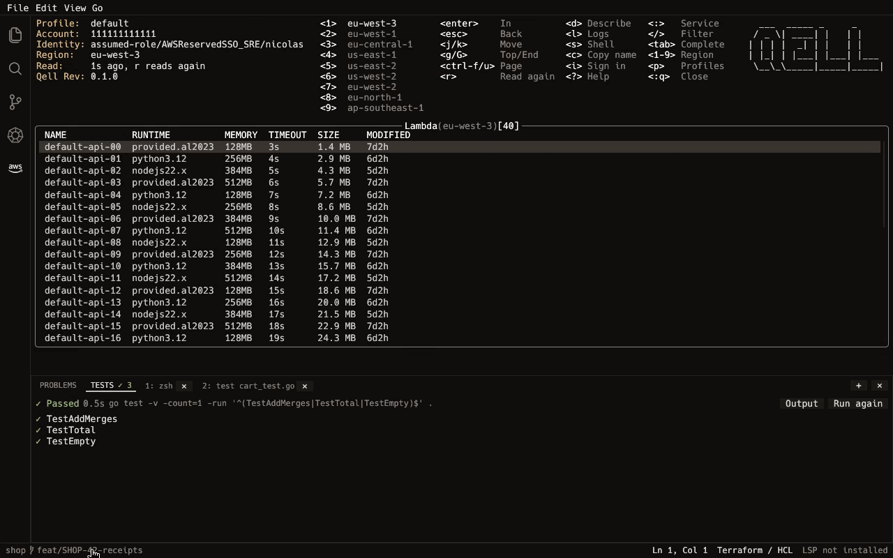

# AWS

`Ctrl/⌘+Shift+A` — or the AWS mark in the activity bar — opens the same
kind of view for an AWS account. `:` picks a service; `:` alone lists them.

| Type | Lists | `Enter` goes into |
|---|---|---|
| `:lambda` `:fn` | functions | details |
| `:cloudfront` `:cf` | distributions | invalidations |
| `:codedeploy` `:cd` | applications | latest deployments, with why a failed one failed |
| `:codepipeline` `:cp` | pipelines | each stage and action, the stuck one in red |
| `:codebuild` `:cb` | projects | latest builds |
| `:s3` | buckets | folders and objects |
| `:ec2` | instances | details |
| `:ecs` | clusters | services, then tasks |
| `:rds` / `:aurora` | instances / clusters | details |
| `:iam` / `:users` | roles / users | a role's policies |
| `:ssm` `:params` | Parameter Store names and types — never values | details |
| `:stepfunctions` `:sfn` | state machines | latest executions |
| `:sqs` | queues, their depth and dead-letter queue | details |
| `:cognito` | user pools | app clients |
| `:apigateway` `:api` | REST, HTTP and WebSocket APIs | stages |

## Keys

| | |
|---|---|
| `Esc` | back |
| `/` | filter |
| `d` | everything aws said about the row |
| `1`–`9` | region |
| `p`, `:profile prod` | profile |
| `l` | follow a function's or a build's logs |
| `s` | a shell on an instance (Session Manager) or in an ECS task (ECS Exec) |
| `c` | copy the ARN, `s3://` address or name |
| `r` | read the list again |
| `i` | sign in again (`aws sso login`) when the session has expired |

The header says which account and identity you're looking through.

It reads everything through **your own `aws` CLI**, with your profiles,
SSO sessions and assumed roles. Qell holds no credentials and installs
nothing. Nothing is on a timer: a list is read when you open it and when
you press `r`. This version only reads — it changes nothing in your
account.
