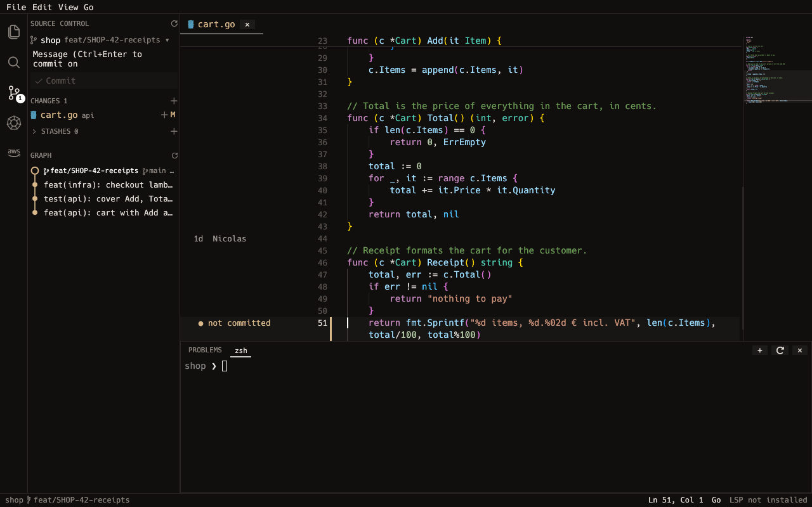

# Git

Qell reads git in the background and shows it everywhere — it works with a
folder holding several repositories (found up to `git_scan_depth` levels
down), each file coloured by its own.

## Status

- The tree and tabs are coloured like VS Code: modified, added, untracked,
  deleted, conflicted, ignored, with a badge per file and a dot on folders
  holding changes.
- The status bar shows the repository, the branch and how far ahead or
  behind its upstream it is. **Click the branch** to switch.

## Changes in the gutter

Lines added (green), modified (blue) or deleted (a red wedge) since git's
version are marked beside the line numbers, as you type. Click a mark for:

- **Revert** — put those lines back to git's version (in the editor,
  unsaved);
- **Stage** — that change alone into the index, the rest of the file left
  as it is.

## Source Control

`Ctrl/⌘+Shift+G` — for each repository: the staged changes and the other
changes with stage and unstage buttons, and a commit box (`Ctrl/⌘+Enter`
commits). Commits run your hooks and signing; a failing hook shows its
message.

The **Graph** draws the history of `HEAD` and its upstream — branches,
merges and tags. Click a commit to list its files, a file to open its diff
(read-only, with syntax colours; `F7` / `Shift+F7` jump between changes).
Right-click a commit to copy its hash or message.

## Blame

`Ctrl/⌘+Alt+B` (*View → Git Blame*) adds a column beside the line numbers:
the author and age of the commit that last changed each block of lines,
newer commits brighter. Hover for the message and date, click to copy the
hash. It follows your edits — unsaved lines show as *not committed*.

## Branches

Click the branch in the status bar or in Source Control, or run *Git:
Switch Branch…*:

- local branches, newest first, with their upstream and age; the current
  one marked `●`;
- remote ones — picking `origin/feature` checks it out as a local branch
  tracking it;
- type a name that doesn't exist and *Create new branch* makes it where
  you are.

*Git: Create Branch…*, *Delete Branch…* and *Force Delete Branch…* are in
the palette. When git refuses — changes in the way, an unmerged branch —
the message says what to do instead.

## Stash

*Git: Stash* (with an optional message), *Stash (Include Untracked)*, *Pop
Latest Stash*, and *Pop / Apply / Drop Stash…* to pick one. Source Control
lists each repository's stashes under **STASHES**, with *Apply*, *Pop* and
*Drop*, and a **+** to stash what you have.

## Merge conflicts

A file git left with `<<<<<<<` / `=======` / `>>>>>>>` blocks — after a
merge, a rebase or a stash pop — shows them tinted: your side green, the
incoming side blue, the common ancestor grey. Each `<<<<<<<` line ends with
**Accept Current · Accept Incoming · Accept Both**; one click replaces the
block, as one undo step.

From the palette: *Merge: Accept Current / Incoming / Both Change* for the
block around the cursor, *Accept All Current / Incoming* for the whole
file, *Next / Previous Conflict* to move between them. When none are left,
save the file and stage it.
