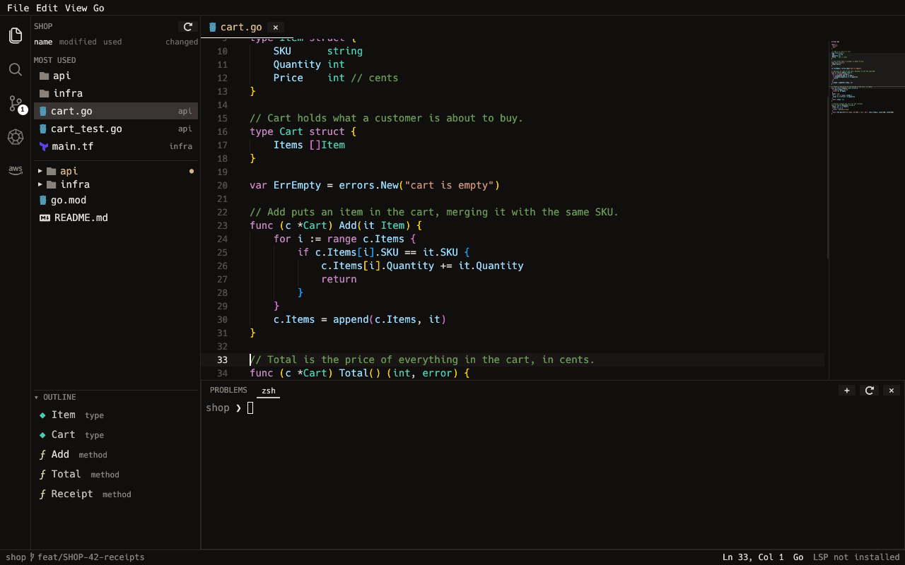

# Qell

Qell is a code editor written in Rust that looks like a terminal: near-black,
off-white, one monospace font, no decoration. One native window holds a file
tree, your code, a terminal at the bottom, and the tools you use every day —
language servers, git, tests, Kubernetes and AWS — without leaving the
keyboard.

## What it is for

Qell was written for backend and infrastructure work: Go, Rust,
TypeScript, Terraform, YAML, shell, Docker, Kubernetes manifests. It opens a
folder — or a folder holding hundreds of repositories — and gives you:

- an editor with multiple cursors, folding, a split view, a minimap, sticky
  scroll and an optional Vim mode;
- completion, go to definition, rename, quick fixes, signature help and
  inlay hints from the language servers you already have;
- git everywhere: changes in the gutter, blame, a Source Control panel,
  branches, stash and a merge conflict resolver;
- terminals that come back where you left them;
- a ▶ beside each test that runs it with your project's own runner;
- k9s-style views of a Kubernetes cluster and an AWS account;
- a daily log of what you did, written for your stand-up.

## What it doesn't do

Qell does **nothing behind your back**. It never downloads or installs
anything: a missing language server is reported with the command to install
it, not fetched. Nothing runs on a timer that you didn't open — the cluster
view refreshes only while you look at it, tests run only when you click,
the daily log talks to an LLM only when you ask for a log. There is no
telemetry and no account.

## Where to go next

- [Install](install.md) Qell on macOS or Linux.
- Take [a tour of the window](tour.md).
- Look up [keyboard shortcuts](keys.md) or [settings](configuration.md).

Qell is open source (MIT or Apache-2.0) — the code, issues and releases are
on [GitHub](https://github.com/sudo-bngz/qell).
