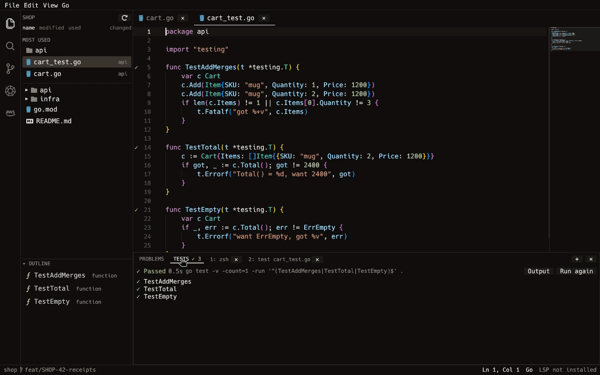

# Running tests

In a test file, a **▶** sits beside each test, left of the line numbers.
Click it to run that test. After the run it turns into **✓** or **✗**.

| | Files | Tests |
|---|---|---|
| Go | `*_test.go` | `func TestX`, `BenchmarkX`, `ExampleX`, `FuzzX` |
| Rust | any `.rs` | `#[test]`, `#[tokio::test]`, `#[async_std::test]` |
| Jest / Vitest | `*.test.*`, `*.spec.*` | `it`, `test`, `describe` — Vitest when `package.json` mentions it |
| pytest | `test_*.py`, `*_test.py` | `def test_…`, `class Test…` |

From the palette: **Test: Run Test at Cursor** (`Ctrl/⌘+Alt+T`), **Run
Tests in File** and **Run Last Again**.

## How they run

Qell uses your project's own runner, from where it expects to be:

| | Runs |
|---|---|
| Go | `go test -v -run '^TestCart$' .` in the package's folder |
| Rust | `cargo test -p <crate> -- --exact 'tests::adds'` from the crate |
| Jest | `npx jest --verbose <file> -t '^…$'` |
| Vitest | `npx vitest run --reporter=verbose <file> -t '^…$'` |
| pytest | `python3 -m pytest -v file.py::TestA::test_b` |

The command runs **in a terminal tab**, so you see its real output, colours
included; afterwards the tab stays as a shell in that folder. The file is
saved first. Nothing runs unless you click.

## Results

The **TESTS** tab beside Problems shows how the run went, how long it took
and the command, with *Run again* and *Output* (the terminal tab). Failures
come first, each with its message — *Sub(3, 1) = 4, want 2* — and a click
opens the failing line. A build error shows as *Build failed*, with where.
