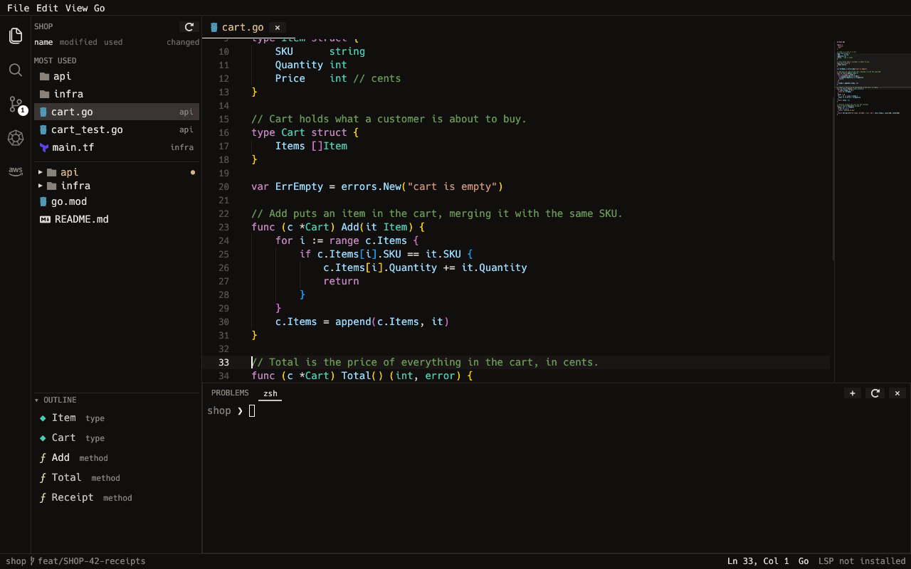

# A tour of the window

From left to right:

- **The activity bar** — Explorer, Search, Source Control (with a badge
  counting changed files), the Kubernetes helm and the AWS mark. Click one
  to show its view, click it again to hide the sidebar (`Ctrl/⌘+B`).
- **The sidebar** — the file tree, search results or Source Control. Under
  the tree sits the **Outline** of the open file.
- **The editor** — tabs on top, line numbers, change marks and test ▶ in
  the gutter, the minimap on the right. It can be split in two
  (`Ctrl/⌘+\`).
- **The panel** — the terminals as tabs, with **PROBLEMS** and **TESTS**
  beside them (`` Ctrl+` `` shows and hides it).
- **The status bar** — the repository and branch (click to switch
  branch), messages, the cursor position, the language and the language
  server's state.

## Getting around

| | |
|---|---|
| **Command palette** | `Ctrl/⌘+Shift+P` — every command, by name |
| **Go to file** | `Ctrl/⌘+P` — fuzzy search over the workspace |
| **Go to line** | `Ctrl/⌘+G` |
| **Go to symbol** | `Ctrl/⌘+Shift+O` — functions, types… in the file |
| **Back / forward** | `Alt+←` / `Alt+→` (`⌃-` / `⌃⇧-` on macOS) |
| **Settings** | `Ctrl/⌘+,` |

On macOS, Qell uses the native menu bar (Qell, File, Edit, View, Go,
Window). Elsewhere the same menus sit at the top of the window.

## Sessions

When you open a folder again, Qell brings back what you had: the open
tabs with their cursors, the split, and the terminals in the folders they
were in. Turn it off with **Restore Session** in Settings.

## Zoom and fonts

`Ctrl/⌘+=` and `Ctrl/⌘+-` zoom the whole window — editor, tree, panel and
bars together; `Ctrl/⌘+0` resets. The editor's font size, the terminal's
and the interface scale are in [Settings](configuration.md).

## Look

Qell has one look: near-black and off-white, like a terminal, with
coloured syntax and coloured file icons. Emphasis is brightness, not
colour — the active tab, the focused side of a split and the current line
are a little brighter than the rest.
